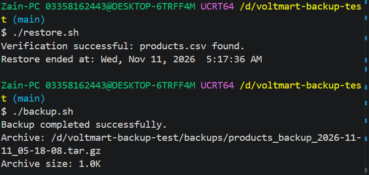

# VoltMart Electronics Backup and Recovery Test

## Project Overview

This project is designed to create a simple backup and recovery solution for VoltMart Electronics.

VoltMart Electronics operates an online catalog of electronic parts and needs a reliable way to protect its data.

## Project Objectives

- Create a documented backup strategy.
- Develop a Bash backup script.
- Store backup files safely.
- Create a restore script.
- Test the backup and recovery process.
- Document the results.

## Technologies Used

- Ubuntu Linux
- Bash Scripting
- Git
- GitHub
- Visual Studio Code
- Markdown

## Project Structure

The project files are organized as follows:

```text
.
├── backup.sh
├── backup_plan.md
├── backup_success.png
├── README.md
├── report.md
├── validation_run.png.jpeg
├── restore.sh
├── backups/
│   ├── backup.log
│   ├── restore.log
│   └── products_backup_<timestamp>.tar.gz
├── products/
│   └── products.csv
└── restore/
    └── products/
        └── products.csv
```

## Expected Outcome

A working and documented backup and recovery process that can be tested on an Ubuntu system.

## Project Level

Beginner

## Client

VoltMart Electronics

## Backup Verification

The backup archive was tested using the `tar` command to confirm that it was readable and contained the `products.csv` file.

The backup log was also checked to verify the backup start time, end time, and archive size.

## Backup Success Screenshot


