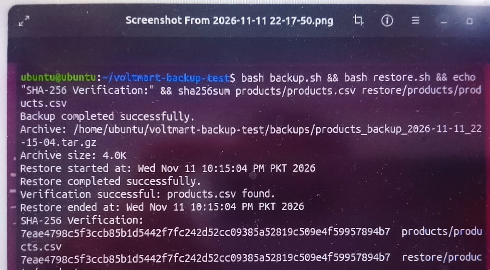

# VoltMart Electronics Backup and Recovery Test Report

## 1. Project Overview

This project demonstrates a basic backup and recovery process for VoltMart Electronics product data.

## 2. Test Method

`backup.sh` and `restore.sh` were run in the actual VoltMart project directory in Ubuntu. `backup.sh` created a timestamped backup archive, and `restore.sh` dynamically selected and restored the latest available backup. The original `products/products.csv` and restored `restore/products/products.csv` were checked using SHA-256; both checksums matched.

## 3. Backup Test

- Script: `backup.sh`
- Method: timestamped `tar.gz` archive of `products/`
- Result: **PASS**
- Verification: a new timestamped archive was created, `tar` listed `products/products.csv` in the archive, and `backups/backup.log` recorded the archive and its size.

## 4. Restore Test

- Script: `restore.sh`
- Destination: `restore/products/products.csv`
- Result: **PASS**
- Verification: an older archive containing different product data was present; restore used the newly created latest archive.
- The restored file existed and its SHA-256 matched the source file: `7eae4798c5f3ccb85b1d5442f7fc242d52cc09385a52819c509e4f59957894b7`.
- `backups/restore.log` was generated.

## 5. Final Result

**PASS** — the backup archive was created and readable, restore selected the latest archive, and the restored CSV matched the original.

## 6. Screenshot Evidence

The screenshot shows the Ubuntu validation run, including successful backup, successful restore, and matching SHA-256 checksums.

